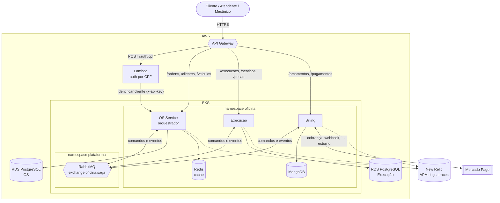

# Oficina Mecânica — OS Service

Serviço de **ordens de serviço** da oficina e **orquestrador da saga** que coordena o atendimento entre os microsserviços. Tech Challenge — Fase 4.

Cuida de usuários internos, clientes, veículos e do ciclo de vida da OS. Toda etapa que depende de outro serviço (diagnóstico, orçamento, pagamento, reparo) é coordenada por mensagens no RabbitMQ, com compensação quando algo falha.

## Repositórios

| Repositório | Papel | Banco |
| --- | --- | --- |
| **oficina-mvp** (este) | OS Service: clientes, veículos, OS, orquestração da saga | PostgreSQL + Redis |
| [oficina-execucao](https://github.com/Xikin/oficina-execucao) | Execução e Produção: fila do mecânico, catálogo, estoque | PostgreSQL próprio |
| [oficina-billing](https://github.com/Xikin/oficina-billing) | Orçamento e Pagamento: aprovação, Mercado Pago, estorno | MongoDB |
| [oficina-auth-lambda](https://github.com/Xikin/oficina-auth-lambda) | Autenticação do cliente por CPF + API Gateway | — |
| [oficina-infra-k8s](https://github.com/Xikin/oficina-infra-k8s) | VPC, EKS, ECR, RabbitMQ | — |
| [oficina-infra-db](https://github.com/Xikin/oficina-infra-db) | RDS do OS Service e do Execução | — |

## Arquitetura geral



Nenhum serviço acessa o banco de outro: cada um recebe só a própria credencial, distribuída pelo pipeline a partir do SSM. A Lambda, que na Fase 3 lia a tabela de clientes, agora chama este serviço por HTTP ([ADR-0013](docs/adr/0013-divisao-em-tres-microsservicos.md)).

## Saga: orquestrada

**Estratégia: saga orquestrada**, com este serviço como orquestrador e o RabbitMQ como transporte. O fluxo completo, o contrato das mensagens e cada cenário de falha estão em **[docs/saga.md](docs/saga.md)**.

```
abrir OS → diagnóstico (Execução) → orçamento (Billing) → aprovação do cliente
        → pagamento (Mercado Pago) → reparo (Execução) → finalizada → entregue
```

**Por que orquestrada e não coreografada.** O fluxo tem ordem rígida (sem orçamento não há pagamento, sem pagamento não há reparo) e só dois participantes. Com um orquestrador, a regra inteira fica numa função pura ([`saga-os.ts`](src/domain/saga/saga-os.ts)), testável sem infraestrutura. A compensação também fica num lugar só, com a lista exata de quem participou, e o estado aparece em `GET /ordens/:id/saga`. Na coreografia, cada serviço precisaria conhecer os eventos dos outros para saber o que desfazer. Comparação completa na [ADR-0014](docs/adr/0014-saga-orquestrada-com-rabbitmq.md).

**Rollback.** Em qualquer falha (orçamento reprovado, pagamento recusado, falha no reparo, cancelamento pela oficina), o orquestrador manda cancelar a todos os participantes envolvidos. O Execução devolve as peças reservadas; o Billing estorna o pagamento no Mercado Pago, se houver. A OS só fica `CANCELADA` quando todos confirmam.

**Garantias** ([ADR-0015](docs/adr/0015-outbox-idempotencia-e-dlq.md)):

| Problema | Solução |
| --- | --- |
| Gravar estado e publicar mensagem não são atômicos | Outbox transacional em todos os serviços; relay com *publisher confirms* |
| Mensagem entregue duas vezes | Consumidor idempotente (`mensagens_processadas`) |
| Duas réplicas alterando a mesma saga | Concorrência otimista (`versao`) |
| Evento chega antes do anterior | Adiado para nova tentativa, não descartado |
| Erro persistente | Retentativa com atraso e fila de mortas (`*.dlq`), com alerta |

## Este serviço

### Responsabilidades

- Cadastro de clientes e veículos, usuários internos e login (`POST /auth/login`).
- Abertura da OS, consulta, histórico, cancelamento (dispara a compensação) e entrega.
- Orquestração da saga: consome `os.saga`, decide o próximo passo, envia comandos.
- Notificação do cliente por e-mail a cada mudança de status (orçamento para aprovar, link de pagamento, conclusão, cancelamento).
- Identificação do cliente por CPF para a Lambda (`POST /integracao/clientes/identificar`, protegido por `x-api-key`).

### Status da OS

`RECEBIDA → EM_DIAGNOSTICO → AGUARDANDO_APROVACAO → AGUARDANDO_PAGAMENTO → AGUARDANDO_EXECUCAO → EM_EXECUCAO → FINALIZADA → ENTREGUE`, além de `CANCELADA`.

Os status mudam pelos eventos da saga, não por chamada manual. As únicas ações manuais sobre o status são `PATCH /ordens/:id/cancelar` e `PATCH /ordens/:id/entregar`.

### Persistência

| Onde | O quê |
| --- | --- |
| PostgreSQL (RDS) | usuários, clientes, veículos, OS, itens orçados (cópia), histórico, `sagas_os`, `passos_saga`, `outbox`, `mensagens_processadas` |
| Redis | cache da consulta pública de status (60 s, invalidado a cada mudança) e contador do limite de tentativas compartilhado entre réplicas |

Escolhas de banco justificadas na [ADR-0016](docs/adr/0016-persistencia-poliglota.md).

### API

- **Swagger:** `<API_GATEWAY_URL>/docs`
- **OpenAPI versionado:** [`docs/openapi.json`](docs/openapi.json), regenerado no CI a cada push
- **Postman:** [`postman/`](postman/)

| Rota | Quem | O que faz |
| --- | --- | --- |
| `POST /ordens` | oficina | Abre a OS e inicia a saga |
| `GET /ordens/:id` | oficina ou dono | OS com itens orçados, histórico e resumo da saga |
| `GET /ordens/:id/saga` | oficina | Etapa, pendências e cada mensagem da saga |
| `PATCH /ordens/:id/cancelar` | oficina | Inicia a compensação (202) |
| `PATCH /ordens/:id/entregar` | oficina | Registra a entrega de OS finalizada |
| `GET /ordens/consulta-publica` | público | Status pelo número da OS e CPF/CNPJ (cache no Redis) |

## Executar localmente

Os três serviços sobem juntos pelo `docker-compose.yml` deste repositório. Clone os três lado a lado:

```bash
git clone https://github.com/Xikin/tech_challenge oficina-mvp
git clone https://github.com/Xikin/oficina-execucao
git clone https://github.com/Xikin/oficina-billing

cd oficina-mvp
cp .env.example .env          # defina POSTGRES_PASSWORD, JWT_SECRET e JWT_CLIENTE_SECRET
docker compose up -d --build --wait

docker compose exec os npx tsx prisma/seed.ts          # usuários, clientes e veículos
docker compose exec execucao node dist/seed.js         # catálogo de serviços e peças

bash scripts/demo-saga.sh feliz       # fluxo completo, da abertura à entrega
bash scripts/demo-saga.sh reprovado   # cliente reprova → compensação
bash scripts/demo-saga.sh falha       # falha depois do pagamento → estorno
```

`scripts/demo-saga.sh` usa `OS_URL`, `EXECUCAO_URL` e `BILLING_URL` (padrão `http://localhost:3000`, ou seja, o API Gateway). No compose, use `OS_URL=http://localhost:3000 EXECUCAO_URL=http://localhost:3001 BILLING_URL=http://localhost:3002`.

| Serviço local | Endereço |
| --- | --- |
| OS Service | http://localhost:3000/docs |
| Execução | http://localhost:3001/docs |
| Billing | http://localhost:3002/docs |
| RabbitMQ Management | http://localhost:15672 (usuário `oficina`) |

> Se você já rodou a Fase 3 com Docker, o volume `oficina_postgres_data` será migrado na primeira subida: os itens das OS antigas são copiados para `itens_os` e as tabelas de catálogo saem deste banco (agora vivem no Execução).

## Testes e qualidade

| Tipo | Ferramenta | Comando | Resultado |
| --- | --- | --- | --- |
| Unitários e de integração | Vitest | `npm test` | 224 testes |
| BDD do fluxo completo | Cucumber | `npm run test:bdd` | 6 cenários, 60 passos |
| Qualidade | SonarQube Cloud | pipeline | quality gate bloqueia a imagem |

**Cobertura** (mínimo exigido pelo pipeline: 80% em linhas, branches, funções e statements):

| Camada | Linhas |
| --- | --- |
| domain | 98,3% |
| application | 97,1% |
| infrastructure | 91,5% |
| presentation | 99,9% |
| **total** | **95,2%** linhas · 92,2% branches · 91,2% funções |

O relatório HTML fica no artefato `coverage` de cada execução do pipeline, e o relatório do Cucumber no artefato `bdd`.

O BDD ([`atendimento-da-os.feature`](tests/bdd/features/atendimento-da-os.feature)) cobre:

- o fluxo completo da abertura à entrega;
- reprovação com compensação;
- falha depois do pagamento com estorno;
- cancelamento pela oficina;
- evento que chega fora de ordem;
- mensagem duplicada.

## CI/CD

`PR → main/homolog`: formatação, typecheck, migrations, build, testes com cobertura, BDD e Sonar com quality gate. `push`: tudo isso, mais a imagem no ECR, o deploy no EKS e o smoke test, que exige `/health/ready` com banco e RabbitMQ conectados.

**Proteção da `main`** (Settings → Branches → Add rule, em cada um dos seis repositórios): exigir pull request antes do merge e exigir os checks `Build & Testes` e `Qualidade (SonarQube Cloud)` (no Terraform, o check `Plan`).

Ordem de implantação entre os repositórios:

```
oficina-infra-k8s → oficina-infra-db → oficina-mvp → oficina-execucao → oficina-billing → oficina-auth-lambda
```

| Secret / variável | Para quê |
| --- | --- |
| `AWS_ACCESS_KEY_ID`, `AWS_SECRET_ACCESS_KEY`, `AWS_SESSION_TOKEN` | Learner Lab (expiram a cada 4 h) |
| `JWT_SECRET`, `JWT_CLIENTE_SECRET` | Publicados no SSM por este pipeline; os outros serviços leem de lá |
| `SONAR_TOKEN` (secret), `SONAR_ORGANIZATION` (variável) | Análise e quality gate no SonarQube Cloud |
| `NEW_RELIC_LICENSE_KEY`, `NEW_RELIC_API_KEY`, `NEW_RELIC_ACCOUNT_ID` | APM e marcador de deploy |
| `SMTP_HOST`, `SMTP_USER`, `SMTP_PASS` | E-mail ao cliente (opcional) |

Detalhes em [docs/cicd.md](docs/cicd.md) e [docs/kubernetes.md](docs/kubernetes.md).

## Observabilidade

New Relic APM nos três serviços, com trace distribuído que atravessa o RabbitMQ: o contexto do trace é gravado junto da mensagem no outbox e aceito pelo consumidor. Assim, uma requisição `POST /ordens` aparece ligada ao processamento no Execução e no Billing. O dashboard ganhou a página **Saga e mensageria** (transições, compensações, retentativas, DLQ, pagamentos) e alertas para mensagem na DLQ, Mercado Pago indisponível e pico de compensações. Ver [`observabilidade/`](observabilidade/).

## Documentação

| Documento | Assunto |
| --- | --- |
| [saga.md](docs/saga.md) | Fluxo, contrato de mensagens, topologia, compensações e falhas |
| [ADRs](docs/adr/README.md) | Decisões; 0013 a 0017 são da Fase 4 |
| [entrega-fase4.md](docs/entrega-fase4.md) | Conteúdo do PDF de entrega e roteiro do vídeo |
| [arquitetura.md](docs/arquitetura.md) | Clean Architecture e camadas |
| [notas-de-implementacao.md](docs/notas-de-implementacao.md) | O porquê das escolhas do código, por arquivo |
| [kubernetes.md](docs/kubernetes.md), [cicd.md](docs/cicd.md) | Manifestos e pipeline |
| [observabilidade/](observabilidade/) | Dashboard, consultas e alertas |
