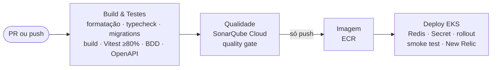

# CI/CD

Workflow: [`.github/workflows/ci-cd.yml`](../.github/workflows/ci-cd.yml). Os serviços de Execução e Billing têm pipelines independentes com a mesma estrutura.

| Gatilho | O que roda |
| --- | --- |
| PR para `main` ou `homolog` | Build & Testes e Qualidade |
| Push em `homolog` | Tudo, com deploy no ambiente `homolog` |
| Push em `main` | Tudo, com deploy no ambiente `prod` |

## Etapas

1. **Build & Testes** — `npm ci`, `format:check`, `prisma migrate deploy` num PostgreSQL de serviço, `typecheck`, `build`, `npm test` (falha abaixo de 80% de cobertura), `npm run test:bdd` e exportação do OpenAPI. Artefatos: `coverage`, `bdd`, `openapi`.
2. **Qualidade** — análise no SonarQube Cloud com `sonar.qualitygate.wait=true`: quality gate reprovado reprova o pipeline e bloqueia a imagem. Sem `SONAR_TOKEN` a etapa falha, em vez de ser pulada.
3. **Imagem** — build multi-stage (Node 24) e push no ECR com as tags `sha-<commit>` e `<ambiente>`.
4. **Deploy** — confere dependências no SSM, publica os segredos compartilhados, aplica Redis e configuração, cria o Secret, faz o rollout da imagem imutável `sha-<commit>`, remove os recursos `oficina-api` da Fase 3 e publica o endereço do NLB. O **smoke test** exige `/health/ready` com banco e RabbitMQ conectados e `401` em rota protegida. Por fim registra o deploy no New Relic.

## Configuração do repositório

| Tipo | Nome | Uso |
| --- | --- | --- |
| Secret | `AWS_ACCESS_KEY_ID`, `AWS_SECRET_ACCESS_KEY`, `AWS_SESSION_TOKEN` | Learner Lab; expiram a cada 4 h |
| Secret | `JWT_SECRET`, `JWT_CLIENTE_SECRET` | Assinatura dos tokens; o mesmo `JWT_CLIENTE_SECRET` vai na Lambda |
| Secret | `SONAR_TOKEN` | SonarQube Cloud |
| Variável | `SONAR_ORGANIZATION`, `SONAR_PROJECT_KEY` (opcional) | Padrão: dono do repositório em minúsculas e `<org>_<repositório>` |
| Secret | `NEW_RELIC_LICENSE_KEY`, `NEW_RELIC_API_KEY`, `NEW_RELIC_ACCOUNT_ID` | APM e marcador de deploy |
| Secret | `SMTP_HOST`, `SMTP_USER`, `SMTP_PASS` | E-mail (opcional) |

## Proteção da `main`

Em Settings → Branches → *Add branch ruleset* para `main`:

- exigir pull request;
- exigir os status checks `Build & Testes` e `Qualidade (SonarQube Cloud)`;
- bloquear *force push*.

Faça o mesmo nos repositórios `oficina-execucao` e `oficina-billing`; nos de Terraform, o check obrigatório é `Plan`.

## SonarQube Cloud

1. Entre em https://sonarcloud.io com a conta do GitHub e importe os repositórios `tech_challenge`, `oficina-execucao` e `oficina-billing`.
2. Em cada projeto, desligue *Automatic Analysis* (a análise vem do pipeline, com a cobertura).
3. Gere um token em *My Account → Security* e grave como `SONAR_TOKEN` nos três repositórios; grave a organização como variável `SONAR_ORGANIZATION`.

Localmente, `npm run sonar` sobe um SonarQube no Docker (perfil `sonar` do compose) e analisa com a cobertura gerada.
