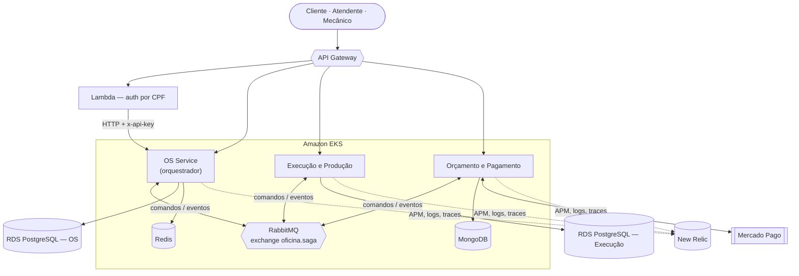

# Entrega — Tech Challenge Fase 4

Rascunho do documento a ser exportado como PDF único no Portal do Aluno.
**Preencha os campos marcados com `<...>` antes de exportar.**

---

## Identificação

| | |
| --- | --- |
| Turma | 13SOAT |
| Fase | 4 |
| Grupo | `<nomes e RMs dos integrantes>` |
| Nuvem | AWS (AWS Academy Learner Lab), região `us-east-1` |

---

## 1. Repositórios

| # | Repositório | URL | Conteúdo |
| --- | --- | --- | --- |
| 1 | OS Service (orquestrador) | `https://github.com/<owner>/tech_challenge` | Clientes, veículos, OS, saga; PostgreSQL + Redis |
| 2 | Execução e Produção | `https://github.com/<owner>/oficina-execucao` | Fila do mecânico, catálogo, estoque; PostgreSQL próprio |
| 3 | Orçamento e Pagamento | `https://github.com/<owner>/oficina-billing` | Orçamentos, Mercado Pago, estornos; MongoDB |
| 4 | Autenticação | `https://github.com/<owner>/oficina-auth-lambda` | Lambda de CPF + API Gateway |
| 5 | Infraestrutura Kubernetes | `https://github.com/<owner>/oficina-infra-k8s` | VPC, EKS, ECR, RabbitMQ |
| 6 | Infraestrutura de banco | `https://github.com/<owner>/oficina-infra-db` | RDS do OS Service e do Execução |

Cada microsserviço tem repositório, Dockerfile, manifestos Kubernetes, pipeline de CI/CD, banco e README próprios, com documentação da arquitetura, evidência de cobertura e Swagger + coleção Postman.

**Usuário `soat-architecture` adicionado como colaborador nos 6 repositórios:** `<confirmar>`

---

## 2. Vídeo de demonstração

| | |
| --- | --- |
| Link | `<YouTube ou Vimeo, público ou não listado>` |
| Duração | `<até 15 minutos>` |

---

## 3. Arquitetura



| Comunicação | Tipo | Exemplo |
| --- | --- | --- |
| Usuário → serviços | REST síncrono via API Gateway | `POST /ordens`, `POST /orcamentos/:id/aprovar` |
| Lambda → OS Service | REST síncrono, chave de integração | `POST /integracao/clientes/identificar` |
| Entre microsserviços | Assíncrona, RabbitMQ | `billing.comando.gerar-orcamento` → `billing.evento.orcamento-gerado` |
| Billing ↔ Mercado Pago | REST + webhook | preferência, consulta, estorno |

**Nenhum serviço acessa o banco de outro.** A Lambda, que na Fase 3 lia a tabela de clientes, passou a chamar o OS Service.

---

## 4. Saga Pattern

**Estratégia escolhida: orquestração**, com o OS Service como orquestrador.

```
abrir OS → diagnóstico (Execução) → orçamento (Billing) → aprovação do cliente
        → pagamento (Mercado Pago) → reparo (Execução) → finalizada → entregue
```

**Por quê:**

- **Ordem rígida, poucos participantes.** O fluxo tem só dois participantes e uma ordem que não muda (sem orçamento não há pagamento, sem pagamento não há reparo). A regra inteira cabe numa função pura, testável sem infraestrutura e exercitada pelo BDD.
- **Compensação num lugar só.** O orquestrador sabe exatamente quem já participou e manda cada um desfazer a própria parte, em paralelo. Na coreografia, cada serviço precisaria conhecer os eventos dos outros para saber o que desfazer.
- **Estado visível.** `GET /ordens/:id/saga` mostra a etapa e cada mensagem trocada.

**Rollback e compensação:**

| Falha | O que é desfeito |
| --- | --- |
| Cliente reprova o orçamento | Peças reservadas voltam ao estoque; OS cancelada |
| Pagamento recusado | Peças voltam; orçamento cancelado; OS cancelada |
| Falha no reparo depois de pago | Pagamento **estornado** no Mercado Pago; peças ainda reservadas voltam; OS cancelada |
| Oficina cancela a OS | O que já tiver acontecido, conforme a etapa |

**Confiabilidade:**

- Outbox transacional nos três serviços.
- Publicação com confirmação do broker.
- Consumidores idempotentes.
- Concorrência otimista por versão.
- Retentativa com atraso e fila de mortas com alerta.

Detalhes em [saga.md](saga.md) e nas ADRs [0014](adr/0014-saga-orquestrada-com-rabbitmq.md) e [0015](adr/0015-outbox-idempotencia-e-dlq.md).

---

## 5. Divisão dos microsserviços e tecnologias

| Serviço | Por que é um serviço | Banco e por quê |
| --- | --- | --- |
| **OS Service** | Dono do cliente, do veículo e do ciclo de vida da OS; é quem conversa com o cliente (e-mail) | **PostgreSQL**: dados relacionais com unicidade (CPF, placa, número da OS) e transação que junta OS, saga e outbox. **Redis**: cache da consulta pública e limite de tentativas compartilhado entre réplicas |
| **Execução e Produção** | O trabalho do mecânico: fila, diagnóstico, reparo; consome peças | **PostgreSQL** próprio: reserva de estoque com baixa condicionada na mesma transação do diagnóstico |
| **Orçamento e Pagamento** | Dinheiro: orçamento congelado, aprovação, cobrança e estorno no Mercado Pago | **MongoDB**: orçamento como documento único (itens congelados, resposta variável do gateway, outbox embutido com atomicidade de documento) |

| Camada | Tecnologia |
| --- | --- |
| Serviços | Node.js 24, TypeScript, Fastify, Zod, Clean Architecture |
| Mensageria | RabbitMQ 4 (exchange topic, filas duráveis, retry com TTL, DLQ) |
| Bancos | PostgreSQL 16 (RDS) com Prisma; MongoDB 8; Redis 7 |
| Pagamento | Mercado Pago Checkout Pro, webhook com assinatura, estorno idempotente |
| Infraestrutura | AWS EKS, ECR, RDS, Lambda, API Gateway, SSM; Terraform |
| CI/CD | GitHub Actions por repositório; SonarQube Cloud com quality gate |
| Testes | Vitest (unitários e integração), Cucumber (BDD) |
| Observabilidade | New Relic APM, logs estruturados e trace distribuído através do RabbitMQ |

Decisões completas nas ADRs [0013](adr/0013-divisao-em-tres-microsservicos.md) (divisão), [0016](adr/0016-persistencia-poliglota.md) (bancos) e [0017](adr/0017-mercado-pago-checkout-pro.md) (Mercado Pago).

---

## 6. Testes e qualidade

| Serviço | Testes | Cobertura (linhas) | BDD |
| --- | --- | --- | --- |
| OS Service | 224 | 95,2% | 6 cenários, 60 passos (fluxo completo + compensações) |
| Execução | 91 | 98,4% | — |
| Billing | 83 | 96,9% | — |
| Lambda | 43 | 99,7% | — |

Os pipelines falham abaixo de 80% de cobertura e com quality gate reprovado no SonarQube Cloud. Painéis do Sonar: `<links>`

---

## Roteiro do vídeo (até 15 minutos)

| Tempo | O que mostrar | Como |
| --- | --- | --- |
| 0:00–1:30 | Arquitetura e a escolha pela orquestração | Diagrama acima; `saga-os.ts` aberto |
| 1:30–5:00 | **Fluxo completo de uma OS** pelos três serviços | `scripts/demo-saga.sh feliz` com `OS_URL=EXECUCAO_URL=BILLING_URL=<gateway>`; em paralelo, o painel do RabbitMQ mostrando as filas |
| 5:00–6:00 | Estado da saga | `GET /ordens/:id/saga` com cada comando e evento |
| 6:00–8:30 | **Saga com falha e compensação** | `scripts/demo-saga.sh falha`: pagamento estornado, peças de volta, OS cancelada. Depois `reprovado` |
| 8:30–9:30 | Resiliência | Parar o Execução (`kubectl scale deploy/oficina-execucao --replicas=0`), abrir OS, mostrar o comando esperando na fila, voltar a escalar e ver a saga continuar |
| 9:30–12:00 | **Deploy automatizado com testes** | PR num microsserviço → checks (testes, cobertura, BDD, Sonar) → merge → imagem no ECR → rollout no EKS → smoke test |
| 12:00–14:30 | **Monitoramento e rastreamento distribuído** | New Relic: trace de `POST /ordens` atravessando os três serviços; página *Saga e mensageria*; alertas 12 a 15 |
| 14:30–15:00 | Fechamento | Repositórios e o que cada um entrega |

Antes de gravar:

- gere um token com `POST /auth/login` e exporte `DEMO_TOKEN`, para não esbarrar no limite de 5 logins a cada 15 minutos;
- rode o seed do Execução uma vez (o pipeline já roda o Job do catálogo).

---

## Checklist dos requisitos

| Requisito | Onde está |
| --- | --- |
| ≥ 3 microsserviços, cada um com repositório, infra e banco | 3 repositórios de serviço; RDS do OS, RDS do Execução, MongoDB do Billing |
| ≥ 1 SQL e ≥ 1 NoSQL | PostgreSQL (2) e MongoDB (+ Redis como cache) |
| REST síncrono e mensageria assíncrona | Fastify via API Gateway; RabbitMQ entre serviços |
| Nenhum serviço acessa o banco de outro | Credenciais por serviço; Lambda chama o OS por HTTP |
| Saga com rollback e compensação; escolha justificada no README | OS Service, `docs/saga.md`, ADR-0014, README |
| Testes unitários em todos os serviços | Vitest nos 3 serviços e na Lambda |
| Fluxo completo com BDD | `tests/bdd/features/atendimento-da-os.feature` |
| Cobertura ≥ 80% por serviço | Thresholds no `vitest.config.ts`; tabelas nos READMEs |
| Qualidade no CI (Sonar) | Etapa `Qualidade` com quality gate nos 3 pipelines |
| Pipeline independente com build, testes, qualidade e deploy em K8s | `.github/workflows/ci-cd.yml` em cada serviço |
| Repositórios protegidos | `<configurar ruleset da main nos 6 repositórios — ver docs/cicd.md>` |
| Mercado Pago | Billing: Checkout Pro, webhook, estorno |
| Observabilidade da Fase 3 | New Relic nos 3 serviços, dashboard e alertas atualizados |
| Swagger ou Postman atualizado | `docs/openapi.json` e `postman/` em cada serviço |
