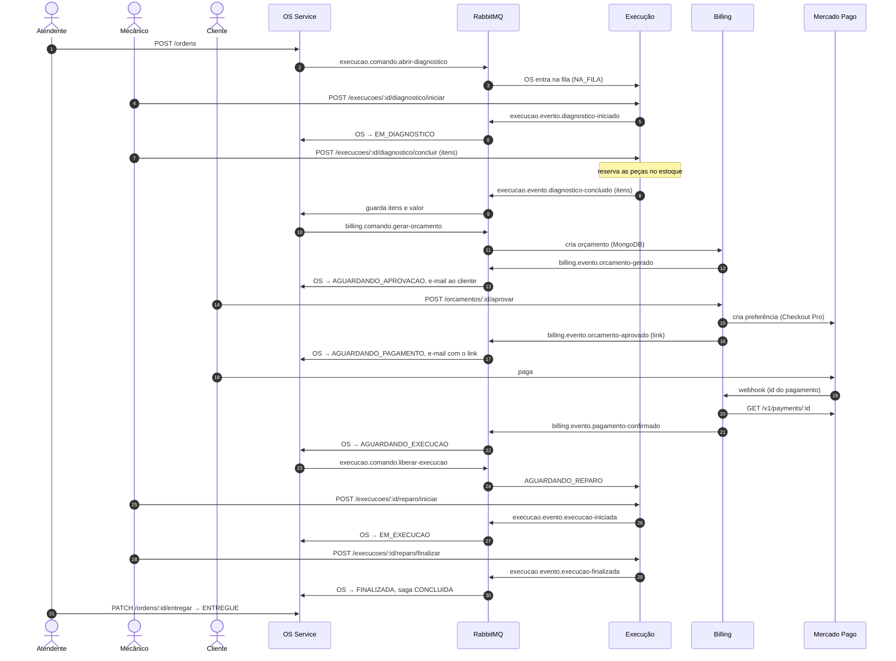
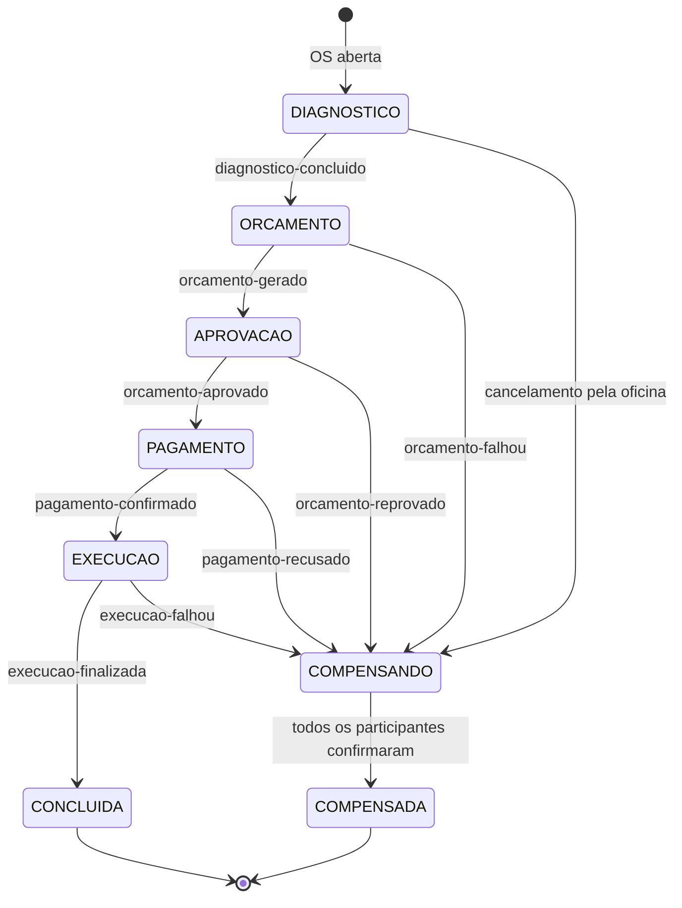
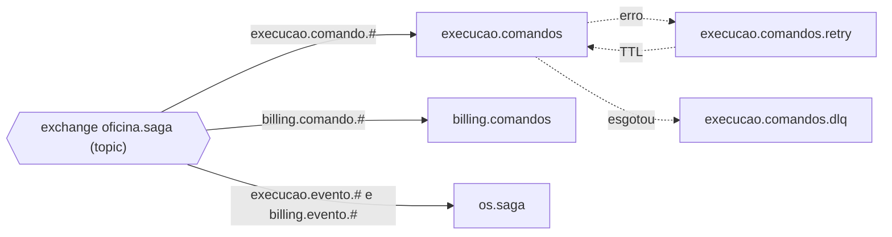

# Saga de atendimento da OS

Como abertura, diagnóstico, orçamento, aprovação, pagamento e reparo avançam juntos entre os três serviços, e como uma falha em qualquer etapa é desfeita. As decisões estão nas ADRs [0014](adr/0014-saga-orquestrada-com-rabbitmq.md) (orquestração) e [0015](adr/0015-outbox-idempotencia-e-dlq.md) (garantias de entrega).

## Participantes

| Papel | Serviço | Fila que consome | O que faz |
| --- | --- | --- | --- |
| Orquestrador | OS Service | `os.saga` | Guarda o estado da saga, decide o próximo passo, envia comandos e atualiza a OS |
| Participante | Execução | `execucao.comandos` | Fila do mecânico, diagnóstico, reserva e consumo de peças, reparo |
| Participante | Billing | `billing.comandos` | Orçamento, aprovação do cliente, cobrança e estorno no Mercado Pago |

## Fluxo feliz



A entrega acontece depois da saga: ela não envolve outro serviço e não tem o que compensar.

## Estados da saga



Além da etapa, a saga guarda `participantes` (quem já recebeu algum comando), `compensacoesPendentes` e `motivoFalha`. O cancelamento manual (`PATCH /ordens/:id/cancelar`) vale em qualquer etapa antes de `CONCLUIDA`.

| Etapa | Status da OS ao entrar | Participantes envolvidos |
| --- | --- | --- |
| `DIAGNOSTICO` | `RECEBIDA`, depois `EM_DIAGNOSTICO` | execução |
| `ORCAMENTO` | `EM_DIAGNOSTICO` | execução, billing |
| `APROVACAO` | `AGUARDANDO_APROVACAO` | execução, billing |
| `PAGAMENTO` | `AGUARDANDO_PAGAMENTO` | execução, billing |
| `EXECUCAO` | `AGUARDANDO_EXECUCAO`, depois `EM_EXECUCAO` | execução, billing |
| `CONCLUIDA` | `FINALIZADA` | — |

## Compensação

Ao entrar em `COMPENSANDO`, o orquestrador envia ao mesmo tempo o comando de cancelamento a **cada participante que já participou**. Cada um desfaz a própria parte e confirma:

| Comando | O participante faz | Confirma com |
| --- | --- | --- |
| `execucao.comando.cancelar` | Cancela a execução e devolve ao estoque as peças ainda reservadas. Se já estava encerrada, não muda nada. | `execucao.evento.cancelada` (`pecasDevolvidas`, `jaEncerrada`) |
| `billing.comando.cancelar` | Se o orçamento estava pago, estorna no Mercado Pago (`ESTORNADO`); senão, cancela (`CANCELADO`). Se já estava encerrado, só reconfirma. | `billing.evento.cancelado` (`estornado`) |

A OS fica `CANCELADA` e o cliente recebe e-mail só quando a **última** confirmação chega. Até lá, `GET /ordens/:id` mostra `saga.status = COMPENSANDO` e a lista de pendentes.

Os participantes **sempre** confirmam, mesmo que o cancelamento chegue antes do comando que ele desfaz (registram a OS como cancelada para ignorar a abertura atrasada) ou depois de a execução já ter terminado. Assim a saga nunca espera para sempre por uma confirmação.

| Cenário | Gatilho | O que é desfeito |
| --- | --- | --- |
| Cliente reprova o orçamento | `orcamento-reprovado` | Peças reservadas voltam ao estoque |
| Pagamento recusado | `pagamento-recusado` | Peças voltam; orçamento cancelado |
| Falha no reparo depois de pago | `execucao-falhou` | Pagamento estornado; peças ainda reservadas voltam |
| Oficina cancela | `PATCH /ordens/:id/cancelar` | O que já tiver acontecido, conforme a etapa |
| Billing não conseguiu gerar o orçamento | `orcamento-falhou` | Peças voltam |

## Contrato das mensagens

Todas as mensagens usam o mesmo envelope JSON, publicado no exchange `oficina.saga` (tipo `topic`) com a *routing key* igual ao `tipo`:

```json
{
  "id": "uuid da mensagem — chave de idempotência",
  "tipo": "billing.evento.orcamento-gerado",
  "versao": 1,
  "sagaId": "uuid da saga",
  "ordemId": "uuid da OS",
  "causadaPor": "id da mensagem que provocou esta, ou null",
  "origem": "oficina-billing",
  "ocorridaEm": "2026-11-10T23:30:00.000Z",
  "dados": { "numeroOS": 42, "...": "..." }
}
```

As propriedades AMQP repetem o essencial (`messageId`, `type`, `correlationId = sagaId`, `appId`) e os cabeçalhos carregam o contexto de rastreamento distribuído do New Relic e o contador `x-tentativas`.

### Comandos (OS Service → participante)

| Tipo | `dados` |
| --- | --- |
| `execucao.comando.abrir-diagnostico` | `numeroOS`, `descricao`, `veiculo { placa, marca, modelo, ano }` |
| `execucao.comando.liberar-execucao` | `numeroOS` |
| `execucao.comando.cancelar` | `numeroOS`, `motivo` |
| `billing.comando.gerar-orcamento` | `numeroOS`, `cliente { id, nome, email }`, `itens[]` |
| `billing.comando.cancelar` | `numeroOS`, `orcamentoId`, `motivo` |

### Eventos (participante → OS Service)

| Tipo | `dados` |
| --- | --- |
| `execucao.evento.diagnostico-iniciado` | `numeroOS` |
| `execucao.evento.diagnostico-concluido` | `numeroOS`, `itens[]`, `observacao?` |
| `execucao.evento.execucao-iniciada` | `numeroOS` |
| `execucao.evento.execucao-finalizada` | `numeroOS`, `tempoRealMin` |
| `execucao.evento.execucao-falhou` | `numeroOS`, `motivo` |
| `execucao.evento.cancelada` | `numeroOS`, `pecasDevolvidas`, `jaEncerrada` |
| `billing.evento.orcamento-gerado` | `numeroOS`, `orcamentoId`, `valorTotal` |
| `billing.evento.orcamento-falhou` | `numeroOS`, `motivo` |
| `billing.evento.orcamento-aprovado` | `numeroOS`, `orcamentoId`, `linkPagamento` |
| `billing.evento.orcamento-reprovado` | `numeroOS`, `orcamentoId`, `motivo` |
| `billing.evento.pagamento-confirmado` | `numeroOS`, `pagamentoId`, `valor` |
| `billing.evento.pagamento-recusado` | `numeroOS`, `motivo` |
| `billing.evento.cancelado` | `numeroOS`, `estornado` |

Item orçado: `{ tipo: "SERVICO" | "PECA", referenciaId, nome, quantidade, precoUnitario }`.

Cada serviço valida o que recebe com Zod. Mensagem fora do contrato vai direto para a fila de mortas, sem retentativa.

## Topologia no RabbitMQ



Cada fila `X` tem `X.retry` (TTL de `MENSAGERIA_ATRASO_RETENTATIVA_MS`, devolve para `X` ao expirar) e `X.dlq`. Cada serviço declara as próprias filas na conexão, e a declaração é refeita a cada reconexão.

| Variável | Padrão | Efeito |
| --- | --- | --- |
| `MENSAGERIA_MAX_TENTATIVAS` | 5 | Tentativas antes da DLQ |
| `MENSAGERIA_ATRASO_RETENTATIVA_MS` | 5000 | Espera entre tentativas |
| `OUTBOX_INTERVALO_MS` | 1000 | Ciclo do relay do outbox |

## O que acontece quando algo falha

| Falha | Comportamento |
| --- | --- |
| RabbitMQ fora do ar | As requisições continuam funcionando; as mensagens ficam no outbox e saem quando o broker volta. `/health/ready` mostra `mensageria: reconectando`. |
| Participante fora do ar | Os comandos esperam na fila durável dele. |
| Comando publicado antes de existir a fila do destino | O broker devolve (`mandatory`), o outbox não marca como publicado e reenvia no ciclo seguinte. |
| Processo cai entre gravar e publicar | O outbox está na mesma transação; o relay publica quando o processo volta. |
| Mesma mensagem entregue duas vezes | Descartada por `mensagens_processadas` (OS e Execução) ou pela transição condicionada (Billing). |
| Duas réplicas alteram a mesma saga | Concorrência otimista por `versao`; a perdedora volta para a fila de retentativa. |
| Evento chega antes do anterior | Etapa futura → adiado para nova tentativa. Etapa passada → registrado e ignorado. |
| Mercado Pago fora do ar no estorno | A compensação falha, é retentada e, esgotadas as tentativas, vai para a DLQ com alerta. A chave de idempotência impede estorno duplo. |
| Pagamento depois do cancelamento | Estornado automaticamente pelo Billing. |

## Onde ver

- `GET /ordens/:id/saga` — etapa, participantes, pendências e cada mensagem enviada ou recebida, em ordem.
- `GET /ordens/:id` — resumo da saga junto com a OS.
- New Relic — eventos `saga_transicao`, `saga_compensacao_iniciada`, `saga_evento_adiado`, `mensagem_falhou`; trace distribuído atravessando os três serviços; consultas em [`observabilidade/consultas.md`](../observabilidade/consultas.md).
- RabbitMQ Management — `kubectl port-forward -n plataforma svc/rabbitmq 15672` e profundidade das filas `*.dlq`.
- BDD — [`tests/bdd/features/atendimento-da-os.feature`](../tests/bdd/features/atendimento-da-os.feature).
